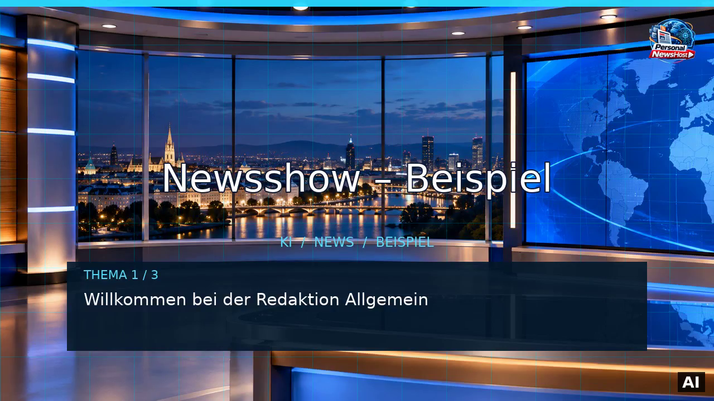

# PersonalNewsHost

**Deine persönliche, automatisch produzierte Nachrichtensendung – aus frei wählbaren RSS-Quellen.**

PersonalNewsHost verwandelt Nachrichten aus RSS-Feeds in eine deutschsprachige Videosendung mit Moderator, Studio, Bildern und Quellenangaben. Die Sendung wird automatisch in der Cloud erstellt und auf einer Webseite mit Video-RSS-Feed veröffentlicht – ohne eigenen Server oder dauerhaft geöffneten Browser.

[**Nachrichtenseite ansehen**](https://ploeffler.github.io/PersonalNewsHost/) · [**Jetzt die aktuelle Sendung ansehen**](https://ploeffler.github.io/PersonalNewsHost/latest.mp4)

## Newsshow-Demo

Vorbereitete Beispielsendung der Redaktion **Allgemein** mit festen Testbeiträgen – keine aktuellen Nachrichten.

[**Newsshow-Demo ansehen / herunterladen**](https://raw.githubusercontent.com/ploeffler/PersonalNewsHost/Full-featured-Newsoutlet/demos/newsshow-demo.mp4) · [GitHub Action](https://github.com/ploeffler/PersonalNewsHost/actions/workflows/example-newsshow.yml?query=branch%3AFull-featured-Newsoutlet)

Die Vorschau ist anklickbar. Das Video enthält deutsche Sprachausgabe und eine dauerhafte AI-Kennzeichnung rechts unten. Die Action aktualisiert diese Demo ausschließlich im Entwicklungsbranch.

## Die aktuelle Nachrichtensendung

<video controls playsinline preload="metadata" width="100%" poster="https://ploeffler.github.io/PersonalNewsHost/assets/background.jpg">
  <source src="https://ploeffler.github.io/PersonalNewsHost/latest.mp4" type="video/mp4">
  Dein Browser kann das Video hier möglicherweise nicht direkt wiedergeben. <a href="https://ploeffler.github.io/PersonalNewsHost/latest.mp4">Video öffnen</a>.
</video>

**Hinweis:** GitHub rendert eingebettete HTML-Videos in README-Dateien nicht zuverlässig als Player. Über den Link oben lässt sich die Sendung direkt öffnen; auf der [Nachrichtenseite](https://ploeffler.github.io/PersonalNewsHost/) ist der Videoplayer vorgesehen.

## Warum PersonalNewsHost?

Die Idee begann mit einer einfachen Frage: Lässt sich aus einem einzigen Prompt Schritt für Schritt ein funktionierendes, automatisches Nachrichtenstudio entwickeln – ohne laufende Zusatzkosten?

PersonalNewsHost dokumentiert genau diesen Weg. Das Projekt verbindet klassische Software, offene Werkzeuge und KI-Technologien. Es soll zeigen, dass KI kein magischer Einzelbaustein ist, sondern aus verschiedenen Verfahren und Programmen besteht, die sinnvoll zusammenarbeiten.

**Das Zielbudget beträgt 0 € pro Monat.** Der Betrieb nutzt kostenlose Kontingente und frei verfügbare Werkzeuge. Deren Grenzen und Nutzungsbedingungen bleiben zu beachten.

## Was kann das Projekt?

- Nachrichten aus selbst gewählten RSS-Quellen zu einer Sendung zusammenstellen.
- Einen anpassbaren Moderator und ein virtuelles Studio verwenden.
- Deutschsprachige Sprache, Nachrichtengrafiken und Bildmaterial kombinieren.
- Die aktuelle Sendung als Video, Webseite und Video-RSS bereitstellen.
- Deutsche Untertitel im Webplayer zuschalten und als SRT herunterladen (ab der nächsten erfolgreich erzeugten Sendung). Die Abschnittsgrenzen folgen der Sprache; die Zeitverteilung innerhalb eines Abschnitts ist angenähert.
- Optional über einen eigenen Telegram-Bot veröffentlichen; Aufbewahrung und Löschung werden direkt im Telegram-Ziel eingestellt.
- In einem eigenen GitHub-Fork unabhängig betrieben werden.

PersonalNewsHost ist ein **laufend weiterentwickelter Prototyp**. Nicht jede geplante oder experimentelle Funktion ist bereits vollständig produktiv erprobt. Es ersetzt keine unabhängige journalistische Faktenprüfung.

## Selbst ausprobieren

Du kannst das Projekt forken und deine eigene Nachrichtensendung einrichten. Die Anleitung führt vom GitHub-Fork bis zur ersten veröffentlichten Sendung:

**[Schritt-für-Schritt-Installation](docs/guide/installation.md)**

## Dokumentation

Die technischen Einzelheiten stehen bewusst nicht mehr in dieser Projektvorstellung:

- [Dokumentationsübersicht / Wiki-Inhalte](docs/guide/index.md)
- [Konfiguration und Datenschutz](docs/guide/konfiguration.md)
- [Betrieb, Telegram und Sicherheit](docs/guide/betrieb-und-sicherheit.md)
- [Technik und Workflows](docs/guide/technik.md)
- [Entwicklungsgeschichte und Roadmap](docs/guide/entwicklung.md)

## Mitmachen

Fehlerberichte, Ideen und Verbesserungen sind willkommen. Wer das Projekt forkt, verwendet seine **eigenen** GitHub Secrets; Zugangsdaten des ursprünglichen Projekts werden nicht übertragen.

---

*PersonalNewsHost – ein Experiment zur automatisierten Nachrichtenproduktion, offenen Technologie und Entwicklung mit KI-Unterstützung.*
